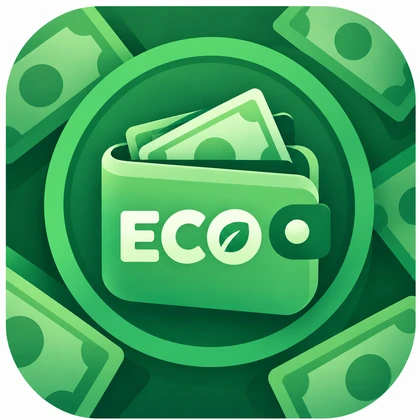
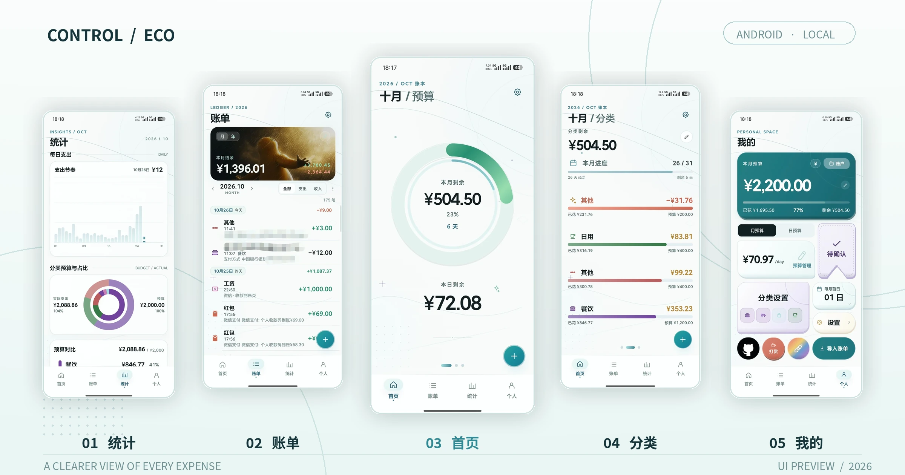
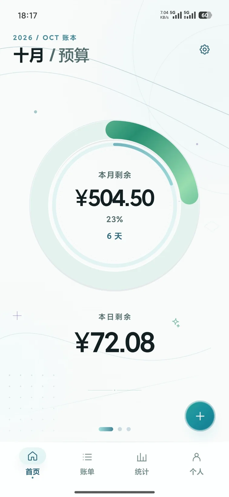
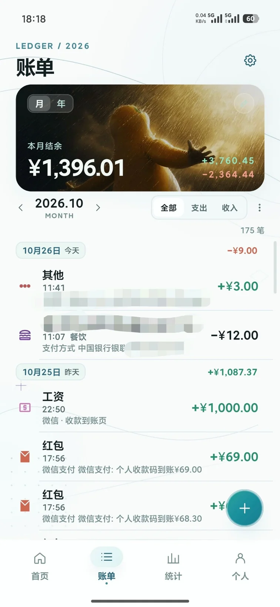
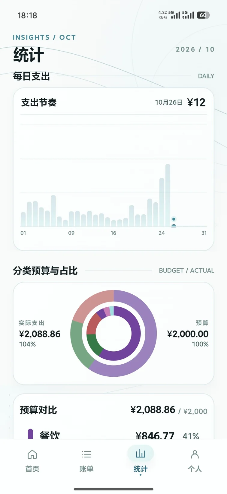
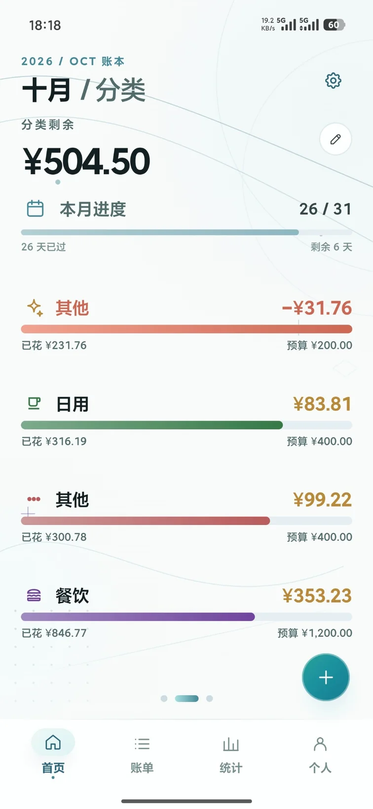
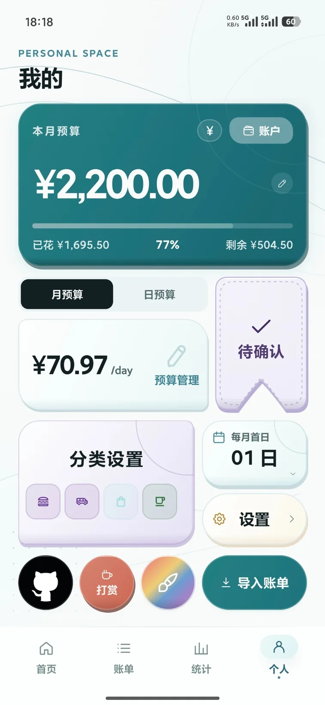

<div align="center">



# 易控钱包 · ControlECO

**让记账自动发生，让每一笔开支都有迹可循。**

本地优先的 Android 自动记账应用。无需注册，自动识别日常收支，轻松管理预算与账单。

[](https://github.com/ArrogHie/ControlECO/releases/latest)
[](https://github.com/ArrogHie/ControlECO/blob/main/gradle/libs.versions.toml)
[](https://github.com/ArrogHie/ControlECO/releases/latest)


**[⬇ 下载 APK](https://github.com/ArrogHie/ControlECO/releases/latest)** · [版本记录](https://github.com/ArrogHie/ControlECO/releases) · [问题反馈](https://github.com/ArrogHie/ControlECO/issues)

</div>

<p align="center">
  
</p>

<details>
<summary>📱 查看单张界面截图</summary>
<br>
<p align="center">
  
  
  
  
  
</p>
</details>

## ✨ 功能亮点

- **自动记账**：通过通知、支付页面、银行短信识别微信、支付宝、云闪付及银行收支，按需开启采集通道。
- **智能去重**：多通道捕获同一笔交易时自动合并；识别不确定的记录进入「待确认」。
- **轻松补账**：支持导入微信、支付宝历史账单，重复导入自动去重，也支持手动新增与修改。
- **预算管理**：月预算、日预算、分类预算与剩余额度一目了然，可自定义每月起始日。
- **账单与统计**：按日查看交易，了解支出趋势、分类占比和预算执行情况。
- **本地优先**：无账号、无广告、无云同步，账本只保存在本机。

## 📦 下载与使用

1. 前往 [GitHub Releases](https://github.com/ArrogHie/ControlECO/releases/latest) 下载 APK；支持 **Android 8.0（API 26）及以上**。
2. 首次使用时，根据需要授权通知使用权、无障碍服务、短信或悬浮窗权限；**只导入历史账单不需要这些采集权限**。
3. 设定预算，开始记账。漏记时可以手动补录或导入历史账单。

> **注意**：Android 13+ 的侧载应用可能需要在「应用信息 → 右上角菜单 → 允许受限制的设置」中解锁相关权限。部分品牌设备还需允许自启动和后台运行。

## 🔐 隐私与数据

交易数据存储于设备本地的应用私有数据库，应用不上传账本，不提供云同步或第三方统计。联网主要用于检查、下载应用更新。

通知、页面和短信读取仅服务于对应记账功能，均可按需开启。**卸载应用会删除应用私有目录中的账本数据**，请谨慎操作。

---

## 🛠 开发者指南

### 技术栈与环境

| 项目 | 配置 |
| --- | --- |
| 开发语言 | **Kotlin 2.0.21** |
| UI | **Jetpack Compose · Material 3** |
| 导航与状态 | Navigation Compose · Lifecycle ViewModel |
| 数据存储 | Room 2.6.1 · SQLite · KSP |
| 构建系统 | Gradle 8.10.2 · Android Gradle Plugin 8.7.3 · Kotlin DSL |
| 开发环境 | **JDK 17** · Android Studio · Android SDK 35 |
| Android 配置 | `minSdk 26` · `targetSdk 35` · `compileSdk 35` |

> 依赖版本以 [`gradle/libs.versions.toml`](gradle/libs.versions.toml) 和 [`app/build.gradle.kts`](app/build.gradle.kts) 为准。

### 本地构建

使用 Android Studio 打开仓库根目录，配置好 JDK 17 与 Android SDK 35，等待 Gradle 同步完成。也可以从命令行执行：

```bash
git clone https://github.com/ArrogHie/ControlECO.git
cd ControlECO

# 构建 Debug APK
./gradlew :app:assembleDebug

# 运行本地单元测试
./gradlew :app:testDebugUnitTest
```

Debug APK 输出位置：`app/build/outputs/apk/debug/app-debug.apk`。

Windows 可将 `./gradlew` 换为 `.\gradlew.bat`。

### 项目结构

```text
ControlECO/
├── app/
│   ├── src/main/             # Android 源码、资源与 Manifest
│   ├── schemas/              # Room Schema（数据库迁移校验）
│   └── build.gradle.kts      # 应用模块与 Android 配置
├── docs/                     # 文档及 README 图片
├── gradle/
│   ├── libs.versions.toml    # 依赖和插件版本
│   └── wrapper/              # Gradle Wrapper
├── tools/                    # 项目辅助工具
├── build.gradle.kts          # 根项目插件配置
└── settings.gradle.kts       # 模块与 Maven 仓库配置
```

> **构建说明**：当前 `release` 构建沿用 debug 签名以兼容既有侧载安装包。若调整签名方案，请先评估应用升级和本地账本数据迁移，避免用户因卸载重装丢失数据。

## 🤝 参与项目

欢迎通过 [Issues](https://github.com/ArrogHie/ControlECO/issues) 提交 Bug、功能建议或适配反馈，也欢迎发起 [Pull Request](https://github.com/ArrogHie/ControlECO/pulls)。

自动识别会受到支付 App 改版及不同手机厂商后台策略影响，反馈时可附 Android 版本、机型及复现步骤（**请勿公开真实交易短信、支付信息等敏感数据**）。

---

<div align="center">
<sub>ControlECO · Keep expenses clear, keep life simple.</sub>
</div>
