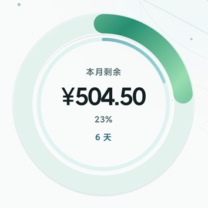

# 预算相关

## 首页

内圆环表示本月剩余天数，外圆环表示本月剩余预算。当剩余预算超出剩余天数时显示绿色，低于时显示黄色，严重低于时显示红色预警。

## 预算计算

首页的 `剩余预算` 和 `本月已花` 仅计入未被 `退款` 和未被标记为 `不计入预算` 的支出账单，对于 `AA` 账单，仅计入**自己所支付的金额**。

统计页的 `实际支出` **不会计入**被 `退款` 的账单，**会计入**被标记为 `不计入预算` 的支出账单，但是对于 `AA` 账单，只计入**自己所支付的金额**。

账单页的 `本月结余` 为所有支出收入的金额总和，不考虑 `退款`、`不计入金额` 和 `AA`。

## 每月首日

设置每月首日为第 $x$ 日后，本月的 $x$ 日起至次月的 $x-1$ 日内的账单统计到本月内。对于次月没有第 $x$ 日的，将次月末日前作为本月结束。

# 自动记账

**因支付场景较多，很难完全处理，因此推荐使用 “悬浮窗入账”，而不是 “自动入账”。以及请打开 “入账提醒” 方便处理。**

## 权限与保活

为了确保自动记账正常运行，请授予软件所需的权限，详细在 `设置`-`权限` 页。为了防止软件被杀后台后需要重新启动权限，请处理软件的保活与自启动相关权限，详细在 `设置`-`保活与自启动`。

当无法进行自动记账或者总是需要去重新打开无障碍功能时，请优先检查 `保活与自启动` 相关。

## 重复记账

当出现重复记账时，如果不属于下面的两种情况之一，请在 `设置`-`开发者功能`-`溯源` 内找到重复记账账单的捕获信息，然后联系作者修复。

部分软件（例如微信），支付成功页没有时间与账单号，对于同一金额的支付成功页，无法判断是同一账单还是相同金额的不同账单。因此记账规则为：短时间内同一金额不进行多次抓取，但是超过时间阈值后会再次抓取。为了防止重复记账，结账后请及时退出支付成功页，长时间不退出支付成功页或者一段时间后再次打开支付成功页会导致重复记账。

对于部分电商平台，使用 微信/支付宝/云闪付 支付后，电商平台仍会弹出支付成功页。因为这两次支付成功页不属于同一软件，所以可能会被认为是不同订单。虽然针对这种情况已经补充了去重规则，但是仍可能有概率出现记重。最好的办法是只使用 微信/支付宝/云闪付 而不使用电商平台的方式进行支付（例如“美团支付”“多多支付”等）。

## 遗漏记账

当出现遗漏记账时，如果不属于下面的两种情况之一，请打开 `设置`-`开发者功能`-`记录所有页面`，然后再次进行支付。支付后进入 `设置`-`开发者功能`-`捕获日志` 内找到支付相关的页面通知和短信信息，然后联系作者修复。如果找不到相关的信息，请联系作者说明支付的软件和机型。

对于部分电商平台，因缺乏易识别的支付成功页或者支付通知，所以无法进行自动识别记账（例如拼多多）。设置内的 `监听的APP` 只表示可以监听，但是对于电商平台的支付稳定性较差，建议使用 微信/支付宝/云闪付 支付。

当支付成功时，请在支付成功页短暂停留一秒，以防止软件未能及时捕获到订单。

对于支付宝，部分机型会保护支付宝的支付成功页，会有小概率不能正常捕获订单，该问题暂未找到解决方法，但是概率较小，影响不大。

## 微信红包

因为微信红包没有信息可以识别是曾经被领取的红包还是现在被领取的红包，所以每次打开微信红包领取页时，都会弹出悬浮窗询问是否需要记录。

## 悬浮窗相关

悬浮窗被设定总是延迟弹出（延迟约1-2s）。对于部分被保护的支付页面，手机会不允许弹出悬浮窗，此时如果正常捕获会发送通知。

# 银行软件无法使用

因为该软件需要获取页面进行账单捕获，所以对于一些安全性较高的软件（例如招商银行app）此时会无法使用。对于此种情况请在后台关掉该软件或者暂时关闭软件的无障碍权限。